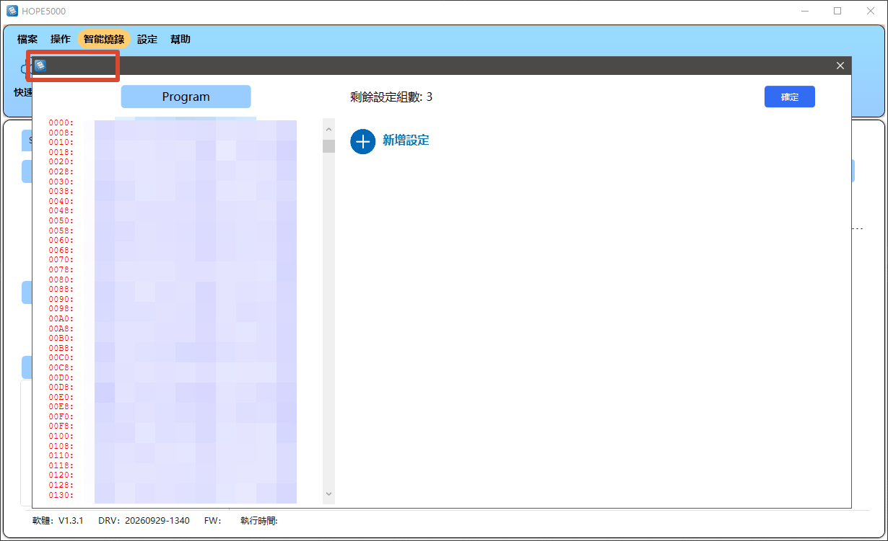
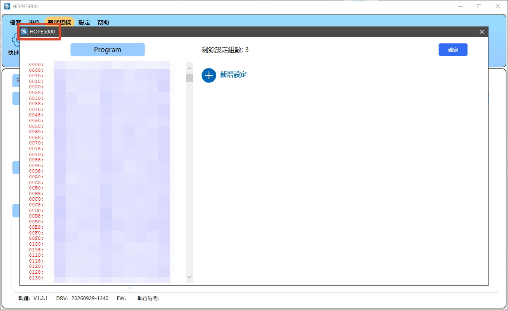

# HOPE5000 子窗口空标题闪退修复





一个无需安装、无需 PowerShell、单文件运行的 [HOPE5000](https://www.holtek.com.cn/page/tool-detail/programmer/p_32/e-writerpro2_32) 修复工具。

它修复 HOPE5000 在点击“自定义烧录/范围选择”后弹出子窗口时闪退的问题(KB5022502/KB5022503已修复此问题)，并允许把该子窗口的标题改成任意自定义名称。工具会自动备份原文件，可随时一键还原。

> 本项目是非官方社区工具，与合泰（Holtek）及其关联公司无任何关系。项目不包含 HOPE5000 本体、反编译源码、用户工程或 DMP 文件。

## 功能

- 修复 `val.Title = ""` 导致的 WPF `Win32Exception` 闪退
- 把子窗口标题改为 `HOPE5000` 或其他自定义名称
- 首次修改前自动创建 `HOPE5000.exe.original.bak`
- 还原后逐字节恢复原文件，并校验 SHA256
- 自动识别常见安装路径，也支持浏览选择和拖放
- 修改前检查 HOPE5000 是否仍在运行
- 严格校验程序集和 IL 特征，不按固定地址盲改
- 单文件 EXE，dnlib 已内嵌，不需要 PowerShell
- 全程离线，不联网，不安装服务，不写注册表

## 快速开始

1. 完全退出 HOPE5000，包括任务栏托盘中的进程。
2. 双击 `HOPE5000TitleFix.exe`。
3. 确认“目标程序”，点击“检查状态”。
4. 输入窗口标题，默认是 `HOPE5000`，然后点击“打补丁”。
5. 启动 HOPE5000，打开“自定义烧录/范围选择”窗口验证。
6. 如需恢复，点击“还原原始文件”。

目标文件也可以直接拖进工具窗口，或通过命令行参数指定：

```text
HOPE5000TitleFix.exe "D:\develop\HOPE5000\BIN\HOPE5000.exe"
```

## 运行要求

- Windows 7 或更高版本
- 与 HOPE5000 相同的 .NET Framework 4.x 桌面运行时，推荐 .NET Framework 4.8
- 目标文件所在目录可写
- 不需要管理员权限；除非 HOPE5000 安装在受保护目录中
- 不需要 PowerShell、Python、Node.js 或 .NET SDK

工具是单文件 GUI 程序。若目标程序位于 `Program Files` 等受保护目录，请右键选择“以管理员身份运行”，否则无法写备份和替换文件。

## 安全设计

1. 只接受程序集名为 `HOPE5000` 的 .NET 可执行文件。
2. 只接受 `HOPE5000.ViewModels.HT8.SmartProgrammingViewModel.ClickRange` 中的特定动态属性赋值序列。
3. 找不到特征时拒绝修改，不会按旧版本固定偏移硬改。
4. 首次补丁前创建原始备份，并验证备份中的标题仍为空。
5. 补丁先写入临时文件，重新读取验证标题后才替换目标。
6. 如果目标目录已有非空标题却没有原始备份，工具拒绝覆盖。
7. 还原时先校验备份，再校验还原后文件 SHA256 与备份完全一致。

备份和元数据默认位于目标文件旁：

```text
HOPE5000.exe
HOPE5000.exe.original.bak
HOPE5000.exe.titlefix.json
```

`.titlefix.json` 只记录修改时间、标题、路径和哈希，不包含用户数据。还原成功后会删除该说明文件，但保留 `.original.bak`。

## 已验证版本

| 项目 | 值 |
|---|---|
| 程序集 | `HOPE5000, Version=1.1.2.0, Culture=neutral, PublicKeyToken=null` |
| 文件大小 | `2,423,808` 字节 |
| 原始 SHA256 | `178E7693F731896DAD905CB0ED7B9A66C710D116E87D7C855C8878EA6D37A87D` |

其他 HOPE5000 版本如果仍包含相同的动态属性赋值序列，可能可以正常工作；工具会在修改前做结构校验。未验证版本请先备份整个安装目录。

## 为什么修改标题能避免崩溃

崩溃发生在应用打开子窗口之后、WPF UI Automation 响应窗口尺寸变化时。原程序把子窗口标题设为空字符串，旧版 .NET/WPF 在读取空标题时把残留的 Win32 错误 `ERROR_FILE_NOT_FOUND (2)` 包装成未处理的 `Win32Exception`，最终导致进程退出。

本工具只改变传入子窗口标题的字符串常量，不修改硬件访问、烧录算法或授权逻辑。详细分析见 [docs/CRASH_ANALYSIS.md](docs/CRASH_ANALYSIS.md)，补丁原理见 [docs/TECHNICAL.md](docs/TECHNICAL.md)。

`AquireAccess fail:3` 是另一条来自厂商授权 DLL 的日志，不是这次未处理异常的抛出点，也不是补丁工具产生的错误。

## 常见问题

### 工具提示“未找到 ClickRange 中设置窗口标题的 IL 序列”

目标版本不兼容。请不要使用旧版 PowerShell 脚本按固定偏移强改；先保留原文件，提交目标程序的版本号、文件大小和 SHA256 以便适配。

### 补丁成功但窗口仍闪退

先确认修改的是实际启动的 `HOPE5000.exe`，并检查是否有自动更新覆盖了文件。若同一子窗口仍有其他异常，请用 WinDbg 确认新 DMP 的异常类型；本补丁只处理空标题触发的这一条路径。

### 杀毒软件或 SmartScreen 报警

发布文件未做商业代码签名，且工具会修改其他 `.exe` 文件，可能被启发式规则误报。请从可信发布页获取文件，并核对 `SHA256SUMS.txt`。不要为绕过报警而关闭整个安全防护。

### 还原后标题还是自定义值

确认 HOPE5000 已完全退出，并检查目标目录中的 `.original.bak` 是否仍存在。工具拒绝使用标题非空的备份，因为那很可能不是原版文件。

## 项目结构

```text
src/                     C# WinForms 源码
lib/dnlib.dll            dnlib 3.x（MIT）
tests/                   补丁/还原冒烟测试
docs/                    崩溃分析、技术说明、构建说明
dist/                    构建后的单文件 EXE
release/                 可分发 ZIP 与校验文件
build.cmd                Windows 构建入口
package.ps1              本地/CI 打包脚本（仅在开发阶段使用）
```

## 构建与测试

安装 .NET Framework 4.8 Developer Pack（或使用 Visual Studio 2019/2022）后，在仓库根目录运行：

```bat
build.cmd
tests\bin\PatcherSmokeTests.exe "C:\path\to\original\HOPE5000.exe"
```

测试只在临时目录中复制并修改目标副本，不会触碰真实安装。详细说明见 [docs/BUILD.md](docs/BUILD.md)。

## GitHub Actions

仓库自带两套 Windows 工作流：

- `.github/workflows/build.yml`
  - 推送到 `main` / `master`、提交 Pull Request 或手动触发时运行；
  - 自动编译 `HOPE5000TitleFix.exe`；
  - 验证内嵌 dnlib 可加载；
  - 上传包含 EXE、README、许可证、第三方声明、文档和 `SHA256SUMS.txt` 的构建产物，保留 14 天。
- `.github/workflows/release.yml`
  - 推送 `v*` 标签时运行；
  - 自动编译并生成 `HOPE5000TitleFix-vX.Y.Z-win.zip`；
  - 生成 EXE 与 ZIP 的 SHA256；
  - 创建或更新对应 GitHub Release，并附加 ZIP、EXE 和校验文件。

发布示例：

```bat
git tag v1.0.0
git push origin v1.0.0
```

也可以在本机生成同样的发布包：

```powershell
.\package.ps1 -Tag v1.0.0
```

GitHub 的 Windows Runner 自带 .NET Framework 编译器和 PowerShell，供 CI 打包使用；最终 EXE 本身仍不依赖 PowerShell。

## 许可证

本项目自身源码采用 MIT License，见 [LICENSE](LICENSE)。

EXE 内嵌 [dnlib](https://github.com/0xd4d/dnlib)，dnlib 采用 MIT License。其版权声明见 [THIRD-PARTY-NOTICES.txt](THIRD-PARTY-NOTICES.txt)。

HOPE5000 及其相关商标、程序和数据归其权利人所有。本项目不授予任何对 HOPE5000 本体的再分发权利。
